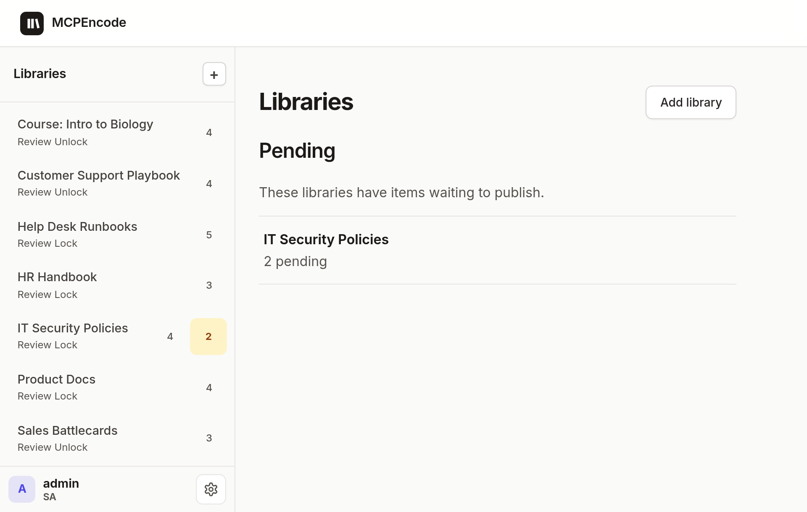
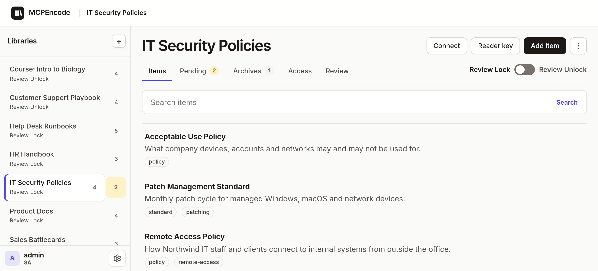

<p align="center">
  
</p>

# MCPEncode

**Trusted, human-approved context for AI agents — served over MCP.**

Your agents need facts they can rely on: the current policy, the real recovery steps, the approved vendor list. Most "AI knowledge" is a pile of documents where nobody can tell an approved procedure from an old draft, and agents fill the gaps by guessing.

MCPEncode keeps that knowledge in **libraries** with a shape you define. Agents can look things up and draft changes. **By default (Review Lock on), only a person can Publish.** Readers and the kiosk only ever read what was published, and they cite an item or say it isn't there.

---

## How it works

1. **Add a library** — a policy, a procedure, or a table you design (e.g. CIS controls, DR scenarios, a vendor register).
2. **Connect an agent** with that library's MCP link. The library's fields become the tool's parameters, so the agent can't invent columns.
3. **The agent drafts** — from an interview, a scan, or a sync. Drafts wait in **Pending**.
4. **A person Publishes** (Review Lock, the default; a Review Unlock library publishes agent writes directly). Now readers and agents see it. Every change is in the audit log, and Revert brings back the last published copy.
5. **Put libraries on a shelf** to search across them; the agent opens the item from the library that owns it before citing it.

<p align="center">
  
</p>

---

## Why it's different

| | Typical RAG / wiki over MCP | MCPEncode |
| --- | --- | --- |
| What the agent reads | Whatever is in the pile | Only published items |
| Who decides what's true | Whoever edited last | A person, at Publish |
| Shape | Free text | Your schema, enforced on every write |
| Schema changes | Anyone, anytime | Agent proposes a field; a person approves |
| Scope of access | Often everything | One library per Connect link, per-library Access |
| Tool output | Raw text | Labelled as data, not instructions |

---

## Quick start

Requires Docker (or Node 22+ and PostgreSQL for development).

```bash
git clone https://github.com/hkrlogic/MCPEncode.git
cd MCPEncode
scripts/init-env.sh         # creates .env with fresh random secrets (incl. SETUP_TOKEN)
docker compose up -d --build
```

Open <http://127.0.0.1:3000/> and create the first account (it is the site admin (SA)). The page asks for a setup code: `SETUP_TOKEN` from your `.env` (`scripts/init-env.sh` generated it), or, if `SETUP_TOKEN` is unset, the one-time code printed in the server log (`docker compose logs app`). Then add a library, add an item, Publish.

To work on the code, run only Postgres in Docker and the app with Node: `docker compose up -d postgres`, `npm install`, `npm start` (see [docs/develop.md](docs/develop.md)).

### Deploy

Use the [`Dockerfile`](Dockerfile) on any container host, with a TLS reverse proxy in front. [docs/deploy.md](docs/deploy.md) lists the environment variables, the `/healthz` check and proxy notes.

> **The first account always needs `SETUP_TOKEN`** (or the one-time code in the server log), so a stranger cannot create it. `scripts/init-env.sh` generates one, and re-running it adds one to an existing `.env` without changing other values. Behind a reverse proxy, set `TRUST_PROXY` (see [docs/deploy.md](docs/deploy.md)).

### Connect an MCP client

Open a library → **Connect** → copy the MCP link into your client. Desktop and editor clients (Cursor, Claude Code, Claude Desktop, VS Code) work as is; hosted clients such as LibreChat or claude.ai sign in through a remote `https` callback, so add their host to `OAUTH_REDIRECT_HOSTS` first ([docs/deploy.md](docs/deploy.md)). Sign in when prompted, then **Allow** on the consent page, which names the app, where the sign-in is sent and the library. That connection sees one library only.

Clients register themselves and get their own client id. Desktop clients (Cursor, Claude Code, Claude Desktop through `mcp-remote`, MCP Inspector, VS Code) return to a loopback address or a known app scheme (`cursor:`, `vscode:`, `vscode-insiders:`, `claude:`, or a reverse-DNS scheme such as `com.example.app:`) and work out of the box. Browser-launcher schemes (`microsoft-edge:`, `x-safari-https:`, `googlechromes:`, `firefox:`, …) are refused. A hosted client that returns to an `https://` site, such as Claude custom connectors on `claude.ai`, needs that hostname in `OAUTH_REDIRECT_HOSTS`. See [docs/deploy.md](docs/deploy.md#mcp-client-sign-in).

> Use `127.0.0.1`, not `localhost` — they are different OAuth audiences.

For a shared agent that only reads, create a **Reader key** on the library and send it as `Authorization: Bearer <key>`.

---

## MCP tools

| Tool | Does |
| --- | --- |
| `list_items` | Look up by question or name. One clear match returns the full item. |
| `open_item` | Full item by id |
| `search_shelf` | Search published items across the library's shelf (summaries only) |
| `create_item` / `update_item` | Save a draft (Review Lock) or publish directly (Review Unlock) |
| `delete_item` | Remove an item |
| `create_library` / `propose_table` / `propose_field` | Design a library; a person approves the schema |
| `list_audit` | Who called which tool in this library (publishers and SA) |
| `whoami` | Current identity and role |

There is **no publish, approve or revert tool.** Those stay with people in the publisher UI.

---

## Concepts

| Idea | Meaning |
| --- | --- |
| **Library** | A set of items with one schema, one Connect link, one Access list |
| **Item** | One entry — name, labels, summary, fields (see [Summaries](#summaries)) |
| **Shelf** | A group of libraries searched together |
| **Review Lock** | Writes stay Pending until a person Publishes (default) |
| **Review Unlock** | Writes publish immediately — for automation output |
| **Entity key** | Stable id (e.g. a hostname) so repeated syncs update one item |
| **Access** | Per-library Publisher / Reader grants |
| **SA** | App admin — accounts, add libraries, hard-delete |

### Summaries

Every item has a summary: the short text `list_items` and `search_shelf` return before an item is opened.

- **General** libraries (no extra fields) have no `summary` input. `create_item` / `update_item` take `name`, `labels` and a markdown `body`, and the summary is built from the body: the text before the first table, or the whole body, flattened to one line (up to 500 characters; lists show the first 160). An empty body falls back to the name.
- **Policy, Procedure, Custom and extended General** libraries take a required one-line `summary` (up to 160 characters) on `create_item` / `update_item`.

---

## Security

- Secrets (`SESSION_SECRET`, `POSTGRES_PASSWORD`, `SETUP_TOKEN`) are generated per install by `scripts/init-env.sh`; the app refuses to start with a placeholder `SESSION_SECRET`.
- Default bind is `127.0.0.1`. The built-in sign-in is meant for local and small-team use — **put MCPEncode behind TLS and set real secrets before exposing it.**
- Disabling or demoting an account takes effect immediately: sessions, tokens and refreshes are re-checked on every request, and an MCP connection's tools come from the re-checked role, not the token.
- Sign-out and a password reset sign the account out everywhere: every session, access token and refresh token. Refresh tokens rotate, a reused one revokes its sign-in, and a sign-in lasts at most `OAUTH_REFRESH_MAX_DAYS` (30).
- A Connect link reaches its own library only, for every role including SA. The audit log on a link shows that library only, to publishers and SA.
- Creating the first account takes a setup code, so a stranger cannot claim a new instance. Sign-in misses back off per username and address instead of locking accounts.
- MCP clients register their own client id and callbacks. By default only loopback callbacks, reverse-DNS app schemes and a short list of known app schemes are accepted; browser-launcher schemes are refused, and remote https hosts must be listed in `OAUTH_REDIRECT_HOSTS`. Every MCP sign-in ends on a consent page that shows the full callback address; a client's self-chosen name is marked unverified. Registration and authorize are rate limited per address. Tokens can only be requested for this app's own libraries.
- A non-loopback `http://` `PUBLIC_BASE_URL` is refused at startup unless `ALLOW_INSECURE_HTTP=true`.
- Tokens are checked for signature, issuer, expiry and audience. Access tokens are never stored.
- Reader keys are stored as SHA-256 hashes and can only read published items.
- Item Markdown never executes raw HTML, and the Content-Security-Policy refuses inline script. Forms carry CSRF; sessions are httpOnly cookies (`__Host-` on HTTPS); sign-out is a POST.

Report vulnerabilities as described in [SECURITY.md](SECURITY.md).

### Known limitations (v0.1)

- **Single instance only.** Pending sign-ins, consent answers, authorization codes, and the sign-in and rate-limit counters live in the app's memory (known-good sign-in addresses are kept in Postgres). Run one app process; a second replica would not see the first one's pending sign-ins.
- **`style-src` still allows `'unsafe-inline'`.** Scripts are strict (`script-src 'self'`); inline styles cannot run code but are still permitted.
- **Connect tokens are stored in plain text** in Postgres, so the publisher can show the link again. Treat database backups as secret. Reader keys are hashed; hashing Connect tokens is planned for v0.2.
- **Review Lock hides edited items.** Editing a published item (by a person or an agent) moves it back to Pending, and readers stop seeing it until someone publishes it again. MCP item output does not yet include the status, so an agent cannot tell. Workaround: publish edits promptly, so the item is out of view only briefly. The fix is planned for v0.2.
- **Pending sign-ins are lost on restart.** Someone in the middle of a sign-in simply starts again; issued tokens survive.

---

## Stack

Node 22 · Express · PostgreSQL 16 (also verified on 17) · OAuth 2.1 + PKCE · MCP

```bash
npm test
npm run typecheck
npm run lint
```

## Docs

| Doc | For |
| --- | --- |
| [AGENTS.md](AGENTS.md) | Product vocabulary and the status gate |
| [docs/develop.md](docs/develop.md) | Run details, tests, security notes, layout |
| [docs/deploy.md](docs/deploy.md) | Docker image, environment, health check, TLS |
| [docs/library-schema-v1.md](docs/library-schema-v1.md) | Starters, propose field, copy/rename |
| [docs/revert-to-published.md](docs/revert-to-published.md) | Overwrite recovery |

## Status

Early (0.1). Maintained in spare time. Issues are welcome; please open one before a large pull request.


## Contributing

See [CONTRIBUTING.md](CONTRIBUTING.md). Report security issues privately — see [SECURITY.md](SECURITY.md).

## License

[Apache License 2.0](LICENSE).
