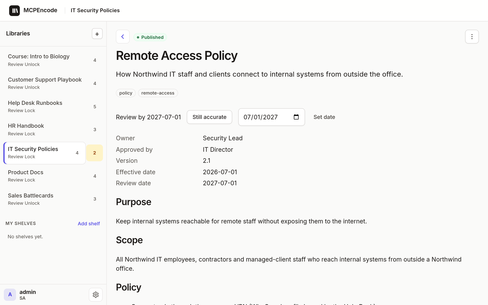
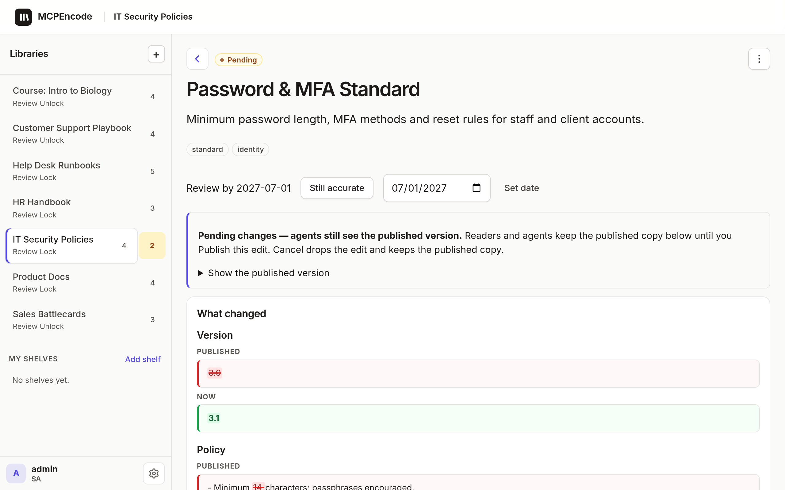
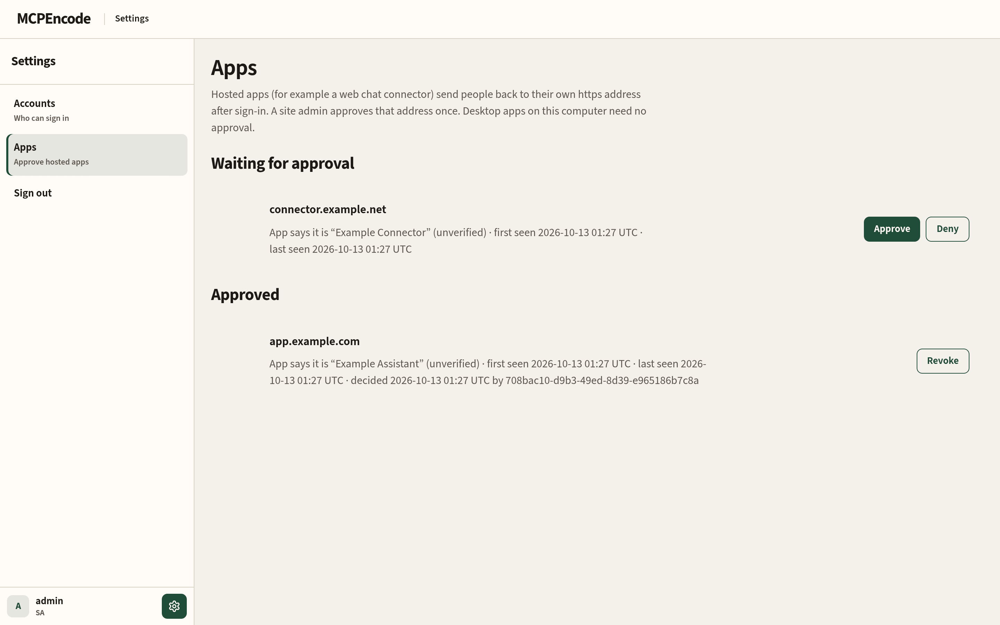
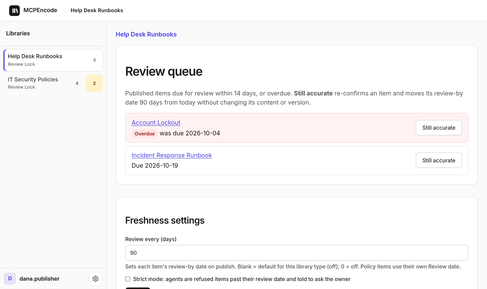
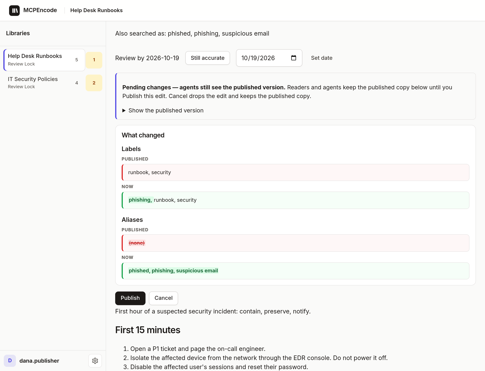
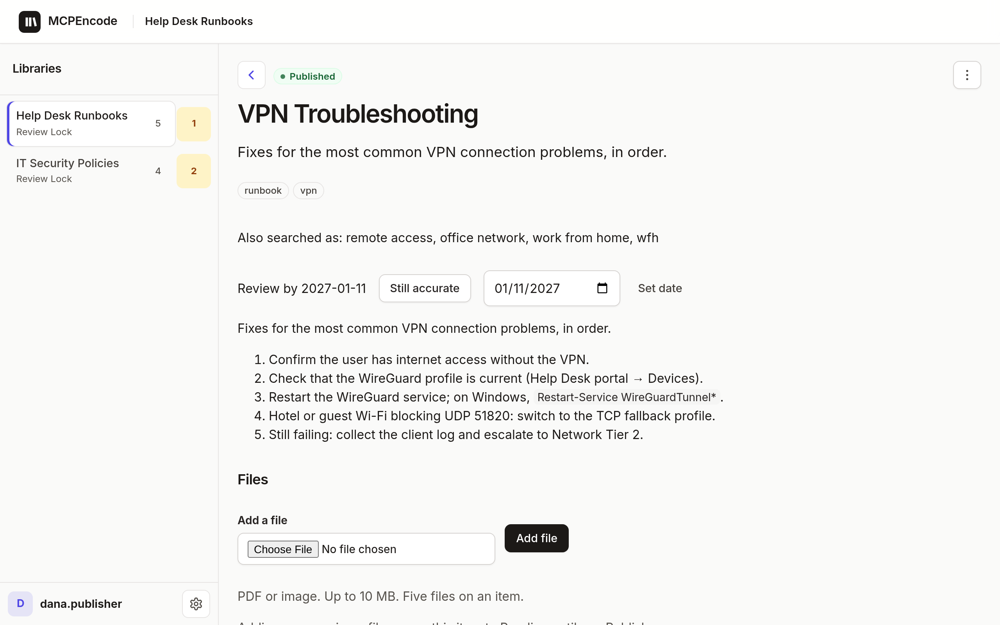
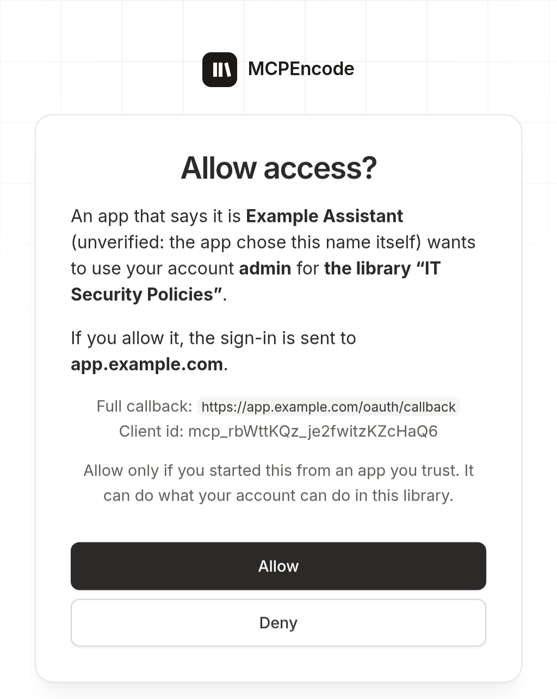

<p align="center">
  
</p>

# MCPEncode

MCPEncode keeps the facts your IT team's AI agents rely on (help desk runbooks, security policies, incident procedures, vendor lists) in **Libraries** of **Items** that people **Publish**. Agents connect to one Library with its **Connect link**, look Items up, and draft changes; with Review Lock (the default) nothing reaches **Readers** until a **Publisher** publishes it. One Node.js app plus PostgreSQL, self-hosted.

- **Citations with version.** Every answer names the published version, date, publisher and link, so you can see where an answer came from.
- **Freshness.** Items get a review-by date (90 days for Policy and Procedure by default). Agents relay a warning when an item is past review, and **strict mode** refuses stale items and points to the owner. A **Review queue** lists what is due, with one-click **Still accurate**.
- **Aliases.** "We got phished" finds the Incident Response runbook. Agents can suggest labels and aliases with `suggest_labels`; a person approves them like any other edit.

**Status:** Early (0.2). Issues welcome; please open one before a large pull request.

## Quick start

Needs Docker with Compose, and `openssl`.

1. **Clone**
   ```bash
   git clone https://github.com/hkrlogic/MCPEncode.git && cd MCPEncode
   ```
2. **Create `.env`** with fresh secrets (safe to re-run; never overwrites a value):
   ```bash
   scripts/init-env.sh
   ```
3. **Start** the app and Postgres:
   ```bash
   docker compose up -d --build
   ```
4. **Open <http://127.0.0.1:3000/>** and create the first account with the setup code: `SETUP_TOKEN` in `.env`. That account is the Site admin. Then add a Library, add an Item, Publish.

`curl http://127.0.0.1:3000/healthz` answers `{"status":"ok","database":"ok"}` when it is up. For a public address (TLS proxy, `PUBLIC_BASE_URL`, `TRUST_PROXY`) see [docs/deploy.md](docs/deploy.md).

## Connect from Cursor or Claude

Open a Library → **Connect** → copy the Connect link. The full link is shown once (when the Library is created, or after **Rotate**); later the dialog shows it masked (`…a1b2`). To get a link again, **Rotate**.

- **Cursor**: Settings → Tools & MCP → add a server with the link as `url` (example: [`.cursor/mcp.example.json`](.cursor/mcp.example.json)).
- **Claude Code**: `claude mcp add --transport http my-library <Connect link>`
- **Claude Desktop**: through `mcp-remote` (`npx mcp-remote <Connect link>` as the server command).
- **Hosted web apps** (claude.ai and other web connectors): connect, then a Site admin approves the app's callback host once (on the sign-in page, or Settings → **Apps**). Or pre-approve it with `OAUTH_REDIRECT_HOSTS=claude.ai` in `.env`. See [Approving apps](docs/deploy.md#approving-apps).

The client opens a browser: sign in, then **Allow** on the consent page. That connection sees this one Library only. Use `127.0.0.1`, not `localhost`, consistently.

## Screenshots

All data below is fictional demo content (`npm run seed-demo`). Left to right: the Libraries home; a published security Policy; a Pending edit (agents keep the published version); approving hosted apps; the **Review queue** for help desk runbooks; an agent's **label and alias suggestion** waiting for review; a runbook with its **review-by date** and **aliases**; the consent page.

| | |
| --- | --- |
|  |  |
|  |  |
|  |  |
|  |  |

## Known limitations

- Run a single app instance; pending sign-ins and rate limits live in memory.

Full list: [docs/known-limitations.md](docs/known-limitations.md).

## Docs

| Doc | For |
| --- | --- |
| [AGENTS.md](AGENTS.md) | AI coding agents: how to deploy, verify, test and contribute |
| [docs/concepts.md](docs/concepts.md) | Roles, Review Lock / Unlock, MCP tools, architecture |
| [docs/deploy.md](docs/deploy.md) | Production, reverse proxy, every setting, upgrades, backups |
| [docs/oidc.md](docs/oidc.md) | External sign-in (Zitadel or another OIDC issuer) |
| [docs/develop.md](docs/develop.md) | Running from source, tests, security notes |
| [docs/known-limitations.md](docs/known-limitations.md) | What v0.1 does not do yet |
| [CHANGELOG.md](CHANGELOG.md) | Releases and breaking changes |

Contributing: [CONTRIBUTING.md](CONTRIBUTING.md). Security reports: [SECURITY.md](SECURITY.md). License: [Apache 2.0](LICENSE).
